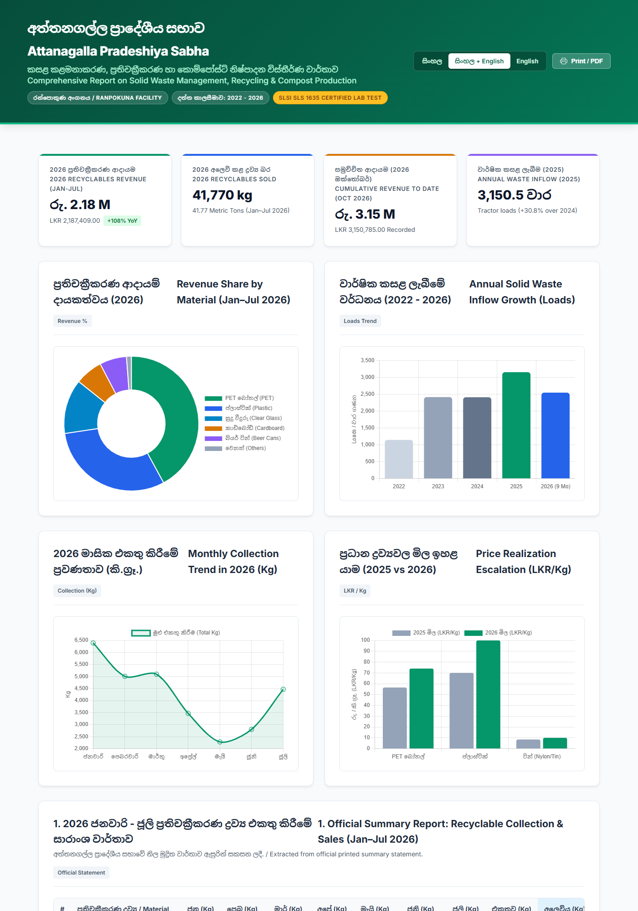

# Attanagalla Pradeshiya Sabha - Waste Management, Recycling & Compost Intelligence Platform
### අත්තනගල්ල ප්‍රාදේශීය සභාව - කසළ කළමනාකරණය, ප්‍රතිචක්‍රීකරණය හා කොම්පෝස්ට් නිෂ්පාදන විස්තීර්ණ වාර්තාව

[](LICENSE)
[](https://github.com/muhzahjr07/document_ocr_azad/releases)
[-green.svg)](#)
[](#)
[](#)

---

## 📌 Dashboard Overview / උපකරණ පුවරුව


---

## 📖 About the Project / ව්‍යාපෘතිය පිළිබඳ හැඳින්වීම

### English
This repository contains the complete digitization, optical character recognition (OCR), multi-year data audit, and interactive bilingual intelligence platform for the solid waste management, recyclable material sales, and organic fertilizer production operations of the **Attanagalla Pradeshiya Sabha** (Gampaha District, Western Province, Sri Lanka) from **2022 to 2026**.

The project was compiled from **28 primary source documents**, including official printed summary reports, handwritten daily intake registers (days 1 to 31 across all months), commercial sales ledgers, and government chemical laboratory quality test certificates from the Horticultural Crops Research & Development Institute in Gannoruwa, Peradeniya.

### සිංහල
මෙම ව්‍යාපෘතිය බස්නාහිර පළාතේ ගම්පහ දිස්ත්‍රික්කයේ **අත්තනගල්ල ප්‍රාදේශීය සභාව** මඟින් ක්‍රියාත්මක කරනු ලබන ඝන අපද්‍රව්‍ය කළමනාකරණය, ප්‍රතිචක්‍රීකරණ ද්‍රව්‍ය අලෙවිය සහ රන්පොකුණ කාබනික කොම්පෝස්ට් පොහොර නිෂ්පාදන ව්‍යාපෘතිය පිළිබඳ 2022 සිට 2026 දක්වා වසර 5 ක නිල ලේඛන 28 ක් පරිලෝකනය (OCR) කර, විශ්ලේෂණය කර සකස් කරන ලද විස්තීර්ණ ද්විභාෂා වාර්තාකරණ සහ දත්ත උපකරණ පුවරුවකි.

---

## 🚀 Key Highlights & Performance Indicators (KPIs)

- **2026 Recycling Revenue (Jan–Jul):** **LKR 2,187,409.00** from 41,770 kg of segregated recyclables.
- **2026 Cumulative Revenue (to mid-October):** **LKR 3,150,785.00** (+108.2% Year-on-Year surge over 2025).
- **Top Revenue Commodities:** 
  - **PET Bottles:** LKR 920,045.00 (42.06% of total revenue)
  - **Rigid Plastics:** LKR 669,375.00 (30.60% of total revenue)
- **Multi-Year Solid Waste Growth:** Daily waste intake at the Ranpokuna facility escalated from **1,144.5 loads (2022)** to **3,150.5 loads (2025)** — a **+175.27% expansion**.
- **Compost Laboratory Certification:** Tested by the Central Soil & Fertilizer Testing Laboratory, Gannoruwa (Lab ID: `Com/2026/02`) under **SLS 1635:2019 / SLS 645**, exhibiting exceptional Nitrogen (**2.20%**, standard >1.0%) and Organic Carbon (**35.06%**, standard >20.0%).

---

## 📊 Summary Tables

### 1. 2026 Recyclables Collection & Sales Summary (Jan–Jul 2026)
| # | ද්‍රව්‍ය වර්ගය / Material | එකතු කිරීම / Collection (Kg) | අලෙවිය / Sold (Kg) | ආදායම / Revenue (LKR) | ඒකක මිල / Realized Rate |
| :-: | :--- | :-: | :-: | :-: | :-: |
| 1 | **පෙට් බෝතල් / PET Bottles** | 5,757.60 | 13,020.00 | **රු. 920,045.00** | Rs. 70.66 / kg |
| 2 | **ප්ලාස්ටික් / Plastic** | 2,476.80 | 7,570.00 | **රු. 669,375.00** | Rs. 88.42 / kg |
| 3 | **සුදු වීදුරු කටු / Clear Glass** | 4,036.25 | 14,300.00 | **රු. 286,000.00** | Rs. 20.00 / kg |
| 4 | **කාඩ්බෝඩ් / Cardboard** | 2,161.00 | 3,870.00 | **රු. 145,125.00** | Rs. 37.50 / kg |
| 5 | **බියර් ටින් / Beer Cans** | 152.80 | 630.00 | **රු. 141,750.00** | Rs. 225.00 / kg |
| 6 | **ටින් / Tin Cans** | 2,490.73 | 1,240.00 | **රු. 13,144.00** | Rs. 10.60 / kg |
| 7 | **රතු/වර්ණ වීදුරු / Amber Glass** | 123.40 | 1,140.00 | **රු. 11,970.00** | Rs. 10.50 / kg |
| 8 | **පොල් කටු / Coconut Shells** | 184.20 | 0.00 (In Stock) | **රු. 0.00** | Reserved |
| 9 | **කළවල බඩු / Mixed Metals** | 12,130.95 | 0.00 (In Stock) | **රු. 0.00** | Reserved |
| **-** | **Total / එකතුව** | **29,513.73 kg** | **41,770.00 kg** | **රු. 2,187,409.00** | **Avg Rs. 52.37/kg** |

---

### 2. 5-Year Solid Waste Intake Audit & Percentage Growth (2022–2026)
| Year | Annual Loads | Monthly Avg | YoY Growth % | Cumulative vs 2022 Base |
| :---: | :---: | :---: | :---: | :---: |
| **2022** | 1,144.50 | 95.38 | **Base Year** | **0.00%** |
| **2023** | 2,412.50 | 201.04 | **+110.79%** 🚀 | **+110.79%** |
| **2024** | 2,408.00 | 200.67 | **-0.19%** | **+110.40%** |
| **2025** | 3,150.50 | 262.54 | **+30.83%** 📈 | **+175.27%** |
| **2026 (Projected)** | **3,393.00** | **282.75** | **+7.70%** | **+196.46%** (~3x baseline) |

---

### 3. How Many Tons Can a Tractor Carry? (Technical & Empirical Proof)
- **Empirical Ledger Proof (Image 13 vs Image 18):**
  - March 2025: 225.25 loads = 229.86 MT $\rightarrow$ **1.02 MT per tractor load**.
  - 3-Month Average: 732.5 loads = 603.36 MT $\rightarrow$ **0.824 MT (824 kg) per tractor load**.
- **Benchmark Standards:**
  - Standard Mixed Waste: **0.8 to 1.2 Metric Tons (800 – 1,200 kg)**
  - Wet Organic / Monsoon Waste: **1.5 to 2.0 Metric Tons (1,500 – 2,000 kg)**
  - Attanagalla Operational Average: **~1.0 Metric Ton per trip**.

---

## 📂 Repository Structure

```
├── Attanagalla_Waste_Management_Report.html   # Interactive bilingual web dashboard
├── Attanagalla_Waste_Management_Report.md     # Full comprehensive research audit
├── RELEASE_NOTES_v1.0.0.md                    # Official v1.0.0 release notes
├── package.json                               # Package and repository metadata
├── LICENSE                                    # MIT License
├── .gitignore                                 # Git ignore file
├── assets/
│   └── screenshots/
│       ├── dashboard_overview.png             # Executive dashboard preview
│       └── full_dashboard.png                 # Full length page capture
└── data/                                      # 28 primary source scans (JPEG)
```

---

## 💻 How to View the Interactive Dashboard

1. **Clone the repository:**
   ```bash
   git clone https://github.com/muhzahjr07/document_ocr_azad.git
   cd document_ocr_azad
   ```
2. **Open the report:**
   - Double click `Attanagalla_Waste_Management_Report.html` in any browser, or run:
   ```bash
   npm start
   ```
   or with Python:
   ```bash
   python -m http.server 8080
   # Open http://localhost:8080/Attanagalla_Waste_Management_Report.html
   ```

---

## 🏷️ Tags & Topics
`waste-management` `recycling` `sri-lanka` `attanagalla-pradeshiya-sabha` `compost-production` `ocr-data-extraction` `bilingual-report` `circular-economy` `local-government` `data-analytics`

---

## 📜 License & Attribution
Distributed under the **MIT License**.  
Primary source data provided by **Attanagalla Pradeshiya Sabha**, Western Province, Sri Lanka.  
Author: **Muhammad Zaharan** ([@muhzahjr07](https://github.com/muhzahjr07))
